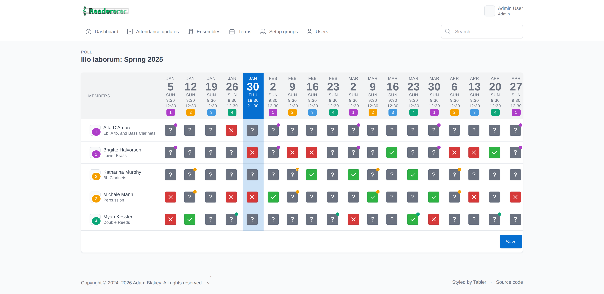

<p align="center">
  
</p>

<p align="center">
  <strong>Attendance, rosters and a digital music library for community ensembles and orchestras.</strong>
</p>

<p align="center">
  
  
  
  <a href="https://github.com/adam-blakey/readererer/releases"></a>
  
  
</p>

<p align="center">
  <a href="https://github.com/adam-blakey/readererer/actions/workflows/deploy.yml"></a>
  <a href="https://github.com/adam-blakey/readererer/actions/workflows/ci.yml"></a>
  <a href="https://github.com/adam-blakey/readererer/actions/workflows/codeql.yml"></a>
  <a href="https://github.com/adam-blakey/readererer/actions/workflows/php-security.yml"></a>
  <a href="https://github.com/adam-blakey/readererer/releases/latest"></a>
  <a href="https://www.conventionalcommits.org"></a>
  <a href="https://readererer.blakey.family"></a>
</p>

---

Readererer is a web application for administering a music ensemble. It records
members, ensembles, rehearsal and concert dates, and attendance. Members reply to a
term's attendance poll, and conductors and committee members view the replies for each
date as attending, not attending or not yet replied. The application also manages
seating plans, setup-group and van-driver rosters, and a library of setlists, pieces
and parts.

## The attendance poll

Each term lists every member against every rehearsal and concert date. Each date has a
three-state control: **attending** (green), **not attending** (red) or **not yet
replied** (grey `?`). Members can change their own answers. Replies are stored as a
history, and totals use the latest reply for each member.



## Features

**Running the calendar (attendance diary)**

- **Members and users** have an instrument family and seat position for each ensemble
  they belong to.
- **Ensembles** can share members. Each ensemble has its own roster and seating.
- **Terms and term dates**: a date with no ensemble is a rehearsal for all members; a
  date with an ensemble is that ensemble's concert. Each term stores its latest date.
- **Attendance polls and register**: polls record three-state replies and give
  attending, not-attending and unknown totals per date. The register records actual
  attendance on the day (present, absent or late) for each member, date and ensemble.
  Poll behaviour is set by the config keys `readererer_assume_attending`,
  `readererer_allow_change_to_unknown` and `readererer_repeating_headings`.
- **Seating plans** set seat rows and columns for each ensemble and can be downloaded
  as a PDF.
- **Setup groups and van drivers** are rosters of who sets up and who drives on each
  date.

**The music library (digital sheet music)**

- **Composers, pieces and parts**: each part belongs to an instrument family.
- **Setlists** group pieces and can be attached to term dates.

**Throughout**

- **Role-based access** uses five roles: `Guest`, `Ensemble`, `Member`, `Moderator`
  and `Admin`. The `Ensemble` role is a shared login that can only fill in polls.
- **Generic CRUD**: most entities use shared index, show and form views that are built
  from the model. A new field needs a migration column and a `$fillable` entry to appear
  in the interface.
- **Soft deletes** allow deleted records to be restored. Index tables are sortable, and
  the interface uses Tabler icons.

## Tech stack

| Layer      | Choice                                                             |
| ---------- | ------------------------------------------------------------------ |
| Framework  | Laravel 13 (PHP 8.4.27+)                                           |
| Frontend   | Blade + [Tabler](https://tabler.io) UI, bundled by Vite           |
| Database   | SQLite (`database/database.sqlite`)                               |
| PDFs       | `barryvdh/laravel-dompdf`                                          |
| Sorting    | `s-damian/larasort`                                               |
| Tests      | [Pest](https://pestphp.com)                                       |
| Formatting | [Laravel Pint](https://laravel.com/docs/pint)                     |

## Getting started

**Requirements:** PHP 8.4.27+, Composer, and Node.js.

```bash
# Install dependencies
composer install
npm install

# Create your environment file and app key
cp .env.example .env
php artisan key:generate

# Create the SQLite database, run migrations and seed sample data
touch database/database.sqlite
php artisan migrate:fresh --seed
```

Start the PHP development server and Vite in two terminals:

```bash
php artisan serve   # http://localhost:8000
npm run dev         # Vite dev server / HMR
```

The seeder creates one user for each role: `guest`, `ensemble`, `member`, `moderator`
and `admin`. All use the password `password`. The `admin` user has full access.

To build assets for production instead of running the development server:

```bash
npm run build
```

### Tests & formatting

```bash
php artisan test                 # or ./vendor/bin/pest
php artisan test --filter 'name of test'
php artisan test --testsuite=Unit,Feature,Browser

./vendor/bin/pint                # format
./vendor/bin/pint --test         # check formatting only
```

Browser tests in `tests/Browser` run in a real browser through
[Pest's browser plugin](https://pestphp.com/docs/browser-testing). They require
Playwright's browsers and the built assets:

```bash
npx playwright install
npm run build
```

`npm run build` must be run before the test suite. `tests/Unit/IconComponentTest.php`
reads the icons that the build copies into `public/build/icons` and fails if they are
missing.

Tests and the Pint check run on every pull request (`.github/workflows/ci.yml`). The
Pint check covers only the PHP files changed in the pull request, because the
repository does not yet pass `pint --test` across all files.

## Docker

The `Dockerfile` builds an image containing Apache, PHP 8.4, the built assets and the
Composer dependencies. Build it with `docker build -t readererer .`. The image contains no `.env` file, so configuration is passed as
environment variables:

```bash
docker run -d --name readererer-dev -p 8080:80 \
  -e APP_KEY="base64:..." \
  -e APP_URL="http://localhost:8080" \
  -v readererer-db:/var/www/html/database \
  readererer
```

`APP_KEY` is required. Generate one with `php artisan key:generate --show` and pass the
printed `base64:` value literally. A `$(...)` substitution is not expanded in a compose
file or env-file and is passed to the application as a string.

On start, the container creates the SQLite database and runs migrations. Mounting a
volume at `/var/www/html/database` keeps the database when the container is replaced.
MySQL can be used instead by setting `DB_CONNECTION`, `DB_HOST` and `DB_DATABASE`.
Setting `APP_SEED_DATABASE=1` also seeds the database after migrating. Setting `SKIP_MIGRATIONS=true` skips migrations at start. Application logs are written
to the container's stderr and can be read with `docker logs readererer-dev`.

## Deployment

Deployment runs through GitHub Actions (`.github/workflows/deploy.yml`) to three
Krystal environments over SSH. Pull requests deploy to dev. Merges to `main` deploy to
dev, then QA, then prod after a wait timer, and publish a GitHub release whose version
is derived from the Conventional Commit messages. See `.github/DEPLOYMENTS.md`.

## Copyright

© 2024–present Adam Blakey. All rights reserved.
